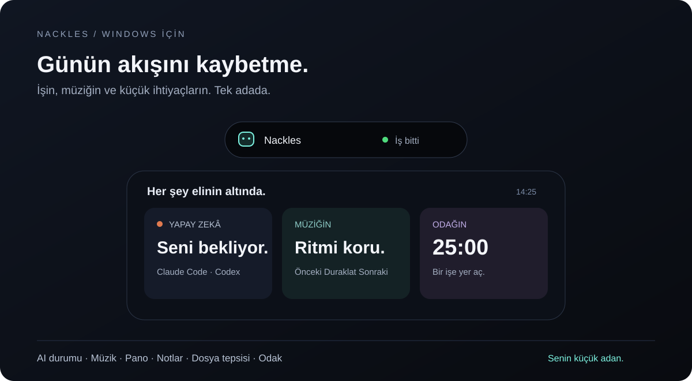

<div align="center">

# Nackles

### Windows'un üstünde küçük bir ada. Gününün ortasında daha az pencere.

Yapay zekânın işini takip et. Müziğini yönet. Kopyaladığını bul. Odağını koru.

[](https://github.com/Mumikros/nackles/releases/latest)
[](LICENSE)
[](#bir-dakikada-başla)

**[Windows için indir →](https://github.com/Mumikros/nackles/releases/download/v1.0.0/Nackles-Kurulum-1.0.0.exe)** · [Sürüm notları](https://github.com/Mumikros/nackles/releases/latest) · [Tam kaynak kodu](https://github.com/Mumikros/nackles/releases/download/v1.0.0/Nackles-1.0.0-kaynak.zip)



<sub>Ürün arayüzünden esinlenen tanıtım çizimi. Windows 10/11 · x64 · Ücretsiz ve açık kaynak.</sub>

</div>

## Bir şeyin bitmesini beklerken sürekli pencere değiştirme.

Claude Code bir işi bitirdi mi? Codex seni mi bekliyor? Az önce kopyaladığın metin neredeydi?

Nackles, sık dönüp baktığın küçük şeyleri ekranının üstündeki tek bir adada toplar. Gerektiğinde açılır; ekranın üstünü kaplayan bir pencereyle çalışırken ince bir çizgiye çekilir. Kod yazarken, müzik dinlerken ya da bir işe odaklanırken elinin altında kalır.

## Küçük adada neler var?

| Gün içinde ihtiyacın olan | Nackles'ta karşılığı |
| :--- | :--- |
| **“Ajanım ne yapıyor?”** | Claude Code ve Codex'in çalışma, bekleme, tamamlanma ve hata durumlarını gör. Desteklenen Claude Code izinlerini adadan yanıtla. |
| **“Şu şarkıyı değiştirsem…”** | Windows medya denetimlerine bağlı oynatıcıları adadan yönet. Spotify ve destekleyen tarayıcılarla çalışır. |
| **“Biraz önce kopyalamıştım.”** | Metin ve görselleri pano geçmişinden tekrar kopyala. Geçmiş uygulama kapanınca temizlenir. |
| **“Bunu unutmamam lazım.”** | Kısa notlarını yaz, yapılacaklarını işaretle. Başka bir not uygulaması açmadan devam et. |
| **“Bu dosyalar burada dursun.”** | Dosyaları tepsiye bırak, aç veya klasörlerinde göster. Filee kuruluysa dönüştürme ve birleştirme seçeneklerini kullan. |
| **“Sadece 25 dakika odaklanacağım.”** | Odak sayacını başlat. İstersen dikkat dağıtan uygulamalarda nefes ekranıyla kendine geri dönme fırsatı ver. |

### Sohbet de elinin altında.

**Claude · Codex · ChatGPT · Gemini** sekmeleriyle sorunu adadan sor. Açıkla, çevir ve özetle gibi hızlı işlemlerle kopyaladığın metin üzerinde çalış.

- **Claude:** bilgisayarındaki Claude Code ve kendi hesabınla.
- **Codex:** bilgisayarındaki Codex aracı ve kendi hesabınla.
- **ChatGPT:** Codex CLI üzerinden, Codex sekmesinden ayrı sohbetle.
- **Gemini:** kendi web arayüzü adanın içinde, ayrı bir web oturumuyla. Google gömülü girişe izin vermeyebilir; giriş henüz doğrulanmadı.

AI araçları isteğe bağlıdır. Müzik, notlar, pano ve odak araçlarını onlar olmadan da kullanabilirsin. AI servislerinin hesap, abonelik ve kullanım sınırları kendilerine aittir.

### Adanın karakterini sen seç.

Asistanına isim ver. Dört maskottan birini seç veya kendi görselini ekle. Renk paletini, sesleri ve görünüm tercihlerini değiştir. Türkçe ya da İngilizce kullan.

## Bir dakikada başla

1. **[Windows kurulumunu indir.](https://github.com/Mumikros/nackles/releases/download/v1.0.0/Nackles-Kurulum-1.0.0.exe)** Windows 10/11 ve x64 gerekir.
2. Kurulumu tamamla ve Nackles'ı aç.
3. **Ctrl + Alt + N** ile adayı sabitle veya aç. Ayarlar'dan kullanmak istediğin özellikleri seç.
4. Claude Code kullanıyorsan Ayarlar'daki **Bağlan** düğmesiyle durum bağlantısını kur.

<details>
<summary><strong>İndirme güvenliği ve bilinen sınırlar</strong></summary>

Kurulum henüz kod imzalı değil; Windows bir uyarı gösterebilir. Dosyanın bu deponun Releases sayfasından geldiğini ve SHA-256 özetini kontrol ederek çalıştırıp çalıştırmayacağına karar ver.

`Nackles-Kurulum-1.0.0.exe` SHA-256:

```text
9343fdd1ba2834038cf9b430aff3eaff126d57e34818fc3c3d5f4ec1941b3d89
```

Gemini gömülü girişi doğrulanmadı. ChatGPT sekmesi ChatGPT web sitesi yerine Codex CLI kullanır. Güvenlik incelemesinde 33 test geçti; bu, yazılımın kusursuz olduğu anlamına gelmez. Derleme bağımlılıklarındaki mevcut uyarılar [inceleme notlarında](RELEASE_NOTES.md) açıklanıyor.

</details>

## Bilgilerin konusunda açık olalım.

**Nackles hesabı, telemetri veya analiz servisi yok.** Notlar ve ayarlar bilgisayarında saklanır. Pano geçmişi bellekte tutulur; uygulama kapanınca silinir. Tanınan özel pano işaretlerine uyulur; işaretlenmemiş parolalar yine de geçmişe girebilir. Pano geçmişini Ayarlar'dan kapatabilirsin.

AI sohbetine gönderdiğin içerik seçtiğin sağlayıcıya gider. Gemini Google'ın sitesini doğrudan yükler; diğer sohbetler kendi kurulu CLI araçlarını kullanır. CLI/MCP yapılandırmaların dosya okuma ve ağ erişimini etkileyebilir.

<details>
<summary>Yerel dosya erişimleri ve gizlilik ayrıntıları</summary>

| Konum / veri | Kullanımı |
| :--- | :--- |
| `~/.claude/settings.json` | Bağlan'ı seçince yalnızca yerel `127.0.0.1` adresine giden hook'lar eklenir. Önce yedek alınır; bağlantıyı kaldırınca Nackles hook'ları kaldırılır. Yerel sunucu rastgele bir token ister. |
| `~/.codex/sessions/**` | Codex etkinliğini göstermek için okunur. İzleme varsayılan olarak açıktır ve kapatılabilir. |
| `%APPDATA%\Nackles\` | Ayarlar, notlar, dosya yolları, son iş başlıkları, özel maskotlar, yerel token, yardımcı program ve döndürülen hata günlükleri saklanır. Profil klasörünü veya ham günlükleri internette paylaşma. İş başlıkları isteminden kısa parçalar içerebilir. |
| Gemini profili | Çerezler ayrı kalıcı profilde tutulur. Normal tarayıcıdan veya CLI'dan çerez aktarılmaz. Siteye script eklenmez. |
| Öndeki pencere | Ada görünürlüğü ve odak koruması için pencere başlığı/programı anlık okunur. Medya yardımcısı bu başlıkları kaydetmez. |
| Dosya tepsisi | Bıraktığın dosyaların yolları tutulur. Silme işlemi istendiğinde dosyalar Geri Dönüşüm Kutusu'na taşınır. |

Pano ve Codex izleme varsayılan olarak açıktır. CLI araçları Nackles dışında kendi sohbet kayıtlarını tutabilir. Ayrıntılar ve özel güvenlik bildirimi için [SECURITY.md](SECURITY.md).

</details>

## Nackles'ın büyümesine katıl

İşine yaradıysa **bir yıldız bırak**, bir arkadaşınla paylaş veya deneyimini [Issues](https://github.com/Mumikros/nackles/issues) üzerinden anlat. Tekrarlanabilir hata raporları, çeviriler ve katkılar projeyi ileri taşır.

**Maddi destek:** bağış hesabı henüz etkin değil. Doğrulanmış ödeme bağlantısı hazır olduğunda burada paylaşılacak. [Destek durumu →](SUPPORT.md)

## Kaynak koddan çalıştır

Şimdilik **[tam kaynak arşivini](https://github.com/Mumikros/nackles/releases/download/v1.0.0/Nackles-1.0.0-kaynak.zip)** indirip aç. Kaynak klasörleri bu arşivin içinde; GitHub'ın otomatik oluşturduğu “Source code” indirmesi yerine bu dosyayı kullan.

Arşivi açtığın klasörde:

```bash
npm ci
npm test
npm start
# Windows kurulumunu derlemek için:
npm run dist
```

## English

**A small island for Windows. Fewer interruptions throughout your day.**

Follow Claude Code and Codex activity, control your music, recover copied text and images, keep quick notes and protect your focus—all from the top of your screen. Personalize it with mascots, colors and your own assistant name.

[Download for Windows x64](https://github.com/Mumikros/nackles/releases/download/v1.0.0/Nackles-Kurulum-1.0.0.exe) · [Complete source archive](https://github.com/Mumikros/nackles/releases/download/v1.0.0/Nackles-1.0.0-kaynak.zip)

Free and MIT-licensed. Turkish and English UI. No Nackles account or analytics. AI conversations use your installed CLI/account or Google's Gemini website. ChatGPT chat currently uses Codex CLI. Embedded Gemini sign-in is not verified. The installer is unsigned; review the release notes before running it. Funding is not enabled yet.

---

[MIT lisansı](LICENSE) · [Güvenlik](SECURITY.md) · [Sürüm notları](RELEASE_NOTES.md) · [Destek](SUPPORT.md)

Nackles bağımsız bir projedir; Anthropic, OpenAI, Google, Apple veya Microsoft ile bağlantılı değildir. Ürün adları sahiplerine aittir. İsteğe bağlı [Filee](https://github.com/KnifeLemon/Filee) entegrasyonu ayrı bir projedir ve pakete dahil değildir.
